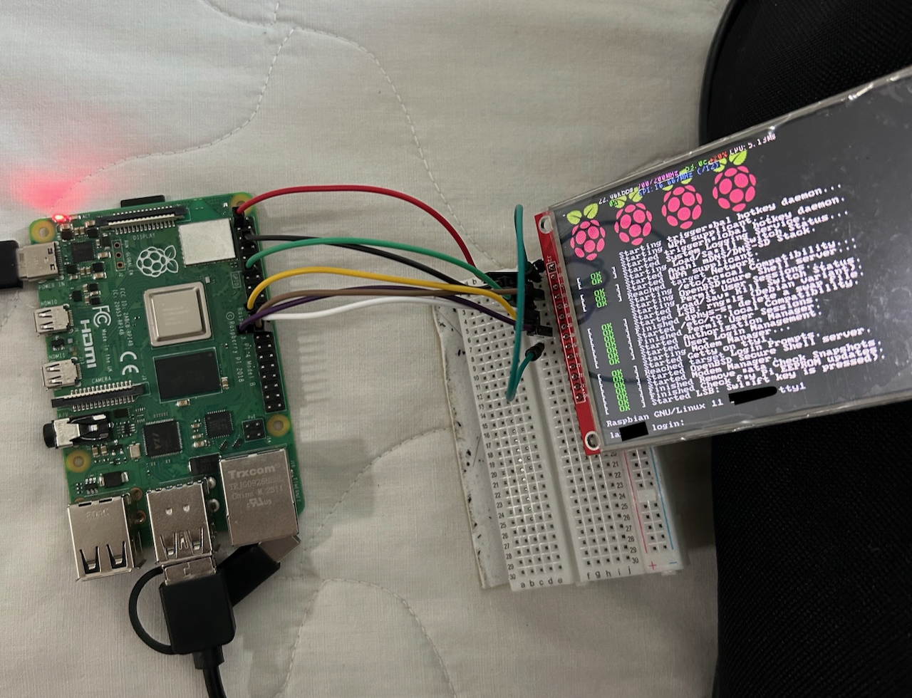

# ILI9488 TFT Display Setup for Raspberry Pi Zero / Zero W

This repository contains a setup script (`setup_ili9488.sh`) that configures a 4" (480×320) **ILI9488 SPI TFT display** on a **Raspberry Pi Zero / Zero W**. The framebuffer is driven by the [fbcp-ili9341](https://github.com/juj/fbcp-ili9341.git) driver, which makes the Linux desktop (or any X application) appear directly on the SPI panel.

> ⚠️ **Works only with Raspberry Pi OS Bookworm!**
> This version of the script is prepared for RPi Zero / Zero W boards and expects a user named `pi` to exist (the boot autostart entry points to `/home/pi/...`).

The display used in this project was purchased at XMKJ Store:
https://www.aliexpress.com/item/1005005791515997.html?spm=a2g0o.order_list.order_list_main.5.47f91802b8PVtk

---

## 📌 Features

- Fully automates the setup of the ILI9488 TFT screen on RPi Zero / Zero W.
- Downloads and builds the `fbcp-ili9341` framebuffer driver with panel-specific options.
- Configures `/boot/firmware/config.txt` (with fallback to `/boot/config.txt`) for a 480×320@60Hz framebuffer.
- Installs a root cron entry so the display starts automatically on every boot (`start_display.sh`).

---

## 🔌 Pinout — Connecting the TFT Display

Connect your ILI9488 TFT screen to the Raspberry Pi Zero / Zero W as follows:

| **TFT Pin** | **Description**       | **GPIO**   | **Pin Number** |
|-------------|-----------------------|------------|----------------|
| **VDD**     | Power (VCC)           | 5V or 3.3V | Pin 2 or Pin 1 |
| **GND**     | Ground                | GND        | Pin 6          |
| **CS**      | Chip Select (SPI CE0) | GPIO 8     | Pin 24         |
| **RST**     | Reset                 | GPIO 25    | Pin 22         |
| **D/C**     | Data/Command (SPI DC) | GPIO 24    | Pin 18         |
| **SDI**     | Serial Data In (MOSI) | GPIO 10    | Pin 19         |
| **SCK**     | Serial Clock (SPI SCLK)| GPIO 11   | Pin 23         |
| **BL**      | Backlight             | 5V or GPIO 27 | Pin 2 or Pin 13 |



### Notes:
- **VDD**: Use Pin 2 (5V) for a brighter backlight, or Pin 1 (3.3V) for power-saving mode.
- **BL (Backlight)**: Connect to 5V (Pin 2) for an always-on backlight, or to GPIO 27 (Pin 13) if you want software-controlled brightness.

---

## 📋 Installation — Step by Step

### 1️⃣ Install Git

Make sure `git` is installed on your Raspberry Pi:

```bash
sudo apt update
sudo apt install -y git
```

### 2️⃣ Download the Setup Script

Clone this repository to your Raspberry Pi:

```bash
git clone https://github.com/grimmorium/ILI9488RPIScript_RaspberryPi_Zero.git
```

### 3️⃣ Run the Setup Script

Change into the script's directory, make it executable, and run it with root privileges:

```bash
cd ILI9488RPIScript_RaspberryPi_Zero
chmod +x setup_ili9488.sh
sudo ./setup_ili9488.sh
```

The script reboots the Raspberry Pi at the end. After reboot, the display should light up automatically (the autostart waits ~10 s after boot).

---

## 🔍 What Does the Script Do?

- **Installs build dependencies**: `cmake`, `build-essential`, `libraspberrypi-dev`.
- **Builds fbcp-ili9341**: clones [juj/fbcp-ili9341](https://github.com/juj/fbcp-ili9341.git) into `/root/fbcp-ili9341` and compiles it with the ILI9488 options (see [Configuration](#⚙️-configuration)).
- **Modifies `config.txt`**: comments out `dtoverlay=vc4-kms-v3d` (the KMS driver conflicts with fbcp) and adds the framebuffer settings listed below. Changed lines are annotated with a date comment; duplicate lines are removed.
- **Sets up autostart**: installs a root cron entry that runs `start_display.sh` on every boot:
  ```cron
  @reboot sleep 10 && /home/pi/ILI9488RPIScript_RaspberryPi_Zero/start_display.sh
  ```
- **Reboots** the Raspberry Pi to apply all changes.

---

## ⚙️ Configuration

### fbcp-ili9341 build options (cmake)

The script builds the driver with these flags:

```bash
cmake -DUSE_GPU=ON -DSPI_BUS_CLOCK_DIVISOR=20 \
      -DGPIO_TFT_DATA_CONTROL=24 -DGPIO_TFT_RESET_PIN=25 \
      -DILI9488=ON -DUSE_DMA_TRANSFERS=OFF \
      -DDISPLAY_SWAP_BGR=ON -DSTATISTICS=0 ..
```

| Option | Value in this script | Description |
|--------|----------------------|-------------|
| `-DILI9488` | `ON` | Enables support for the ILI9488 panel. |
| `-DSPI_BUS_CLOCK_DIVISOR` | `20` | Divisor applied to the base SPI clock — lower values give a faster SPI bus (faster refresh) but may cause artifacts, especially with long ribbon cables. Raise it if you see corrupted pixels or lines. |
| `-DGPIO_TFT_DATA_CONTROL` | `24` | GPIO used for the **D/C** (data/command) line. Change only if your wiring differs. |
| `-DGPIO_TFT_RESET_PIN` | `25` | GPIO used for the **RST** (reset) line. Change only if your wiring differs. |
| `-DDISPLAY_SWAP_BGR` | `ON` | Swaps red and blue channels — corrects wrong colors on this panel. If colors look swapped, toggle it to `OFF`. |
| `-DUSE_GPU` | `ON` | Enables GPU-assisted framebuffer handling for better performance. |
| `-DUSE_DMA_TRANSFERS` | `OFF` | Disables DMA transfers (more stable on RPi Zero). |
| `-DSTATISTICS` | `0` | Disables the on-screen statistics overlay. |

To rebuild after changing any option, run:

```bash
cd /root/fbcp-ili9341/build
rm -rf *
# re-run cmake with your options (see above), then:
make -j1
```

A ready-to-use snippet for rebuilding is provided in [`regen.sh`](regen.sh).

### `config.txt` settings applied by the script

| Setting | Value | Purpose |
|---------|-------|---------|
| `dtoverlay=vc4-kms-v3d` | *(commented out)* | The KMS driver conflicts with fbcp-ili9341, so it is disabled. |
| `hdmi_force_hotplug` | `1` | Forces the framebuffer to be created even though no HDMI display is connected. |
| `hdmi_cvt` | `480 320 60 1 0 0 0` | Defines a custom video mode matching the panel: 480×320 @ 60 Hz. |
| `hdmi_group` | `2` | Selects the "CVT" (custom) mode group. |
| `hdmi_mode` | `87` | Uses the last entry of the custom modes list — i.e. the `hdmi_cvt` mode defined above. |

### Boot autostart (`start_display.sh`)

The driver is started on every boot via a root cron entry:

```cron
@reboot sleep 10 && /home/pi/ILI9488RPIScript_RaspberryPi_Zero/start_display.sh
```

`start_display.sh` launches `fbcp-ili9341` three times in sequence — this "warm-up" reliably wakes the panel after a cold start:

1. **Attempt 1** – wake up the screen (cold start), then stop it;
2. **Attempt 2** – stabilize the panel logic, then stop it;
3. **Attempt 3** – final launch in background (this is the instance that keeps running).

---

## 🛠️ Troubleshooting

### Display not working?
1. Check that all connections match the pinout table above (especially CS, RST and D/C — these are easy to swap).
2. Verify SPI is enabled: `sudo raspi-config` → *Interface Options* → *SPI*.
3. Re-run the setup script to restore the configuration:
   ```bash
   sudo ./setup_ili9488.sh
   ```
4. Check whether the driver is running after boot:
   ```bash
   ps aux | grep fbcp-ili9341
   ```

### Wrong colors (red and blue swapped)?
Rebuild `fbcp-ili9341` with `-DDISPLAY_SWAP_BGR=OFF` instead of `ON`.

### Corrupted pixels / horizontal lines?
Lower the SPI speed by increasing the divisor, e.g. rebuild with `-DSPI_BUS_CLOCK_DIVISOR=40`, and check that the ribbon cable is firmly seated on both connectors.

### Need to reconfigure everything from scratch?
Simply re-run the script — it is idempotent:
```bash
sudo ./setup_ili9488.sh
```

---

## 🖱️ Quick Start (Copy & Paste)

First run `sudo raspi-config` and enable **SPI** (and I2C if needed), disable *login via UART*, and enable the hardware serial/UART. Then copy and paste the commands below sequentially:

```bash
# Update and install git
sudo apt update
sudo apt install -y git

# Clone the setup script repository
git clone https://github.com/grimmorium/ILI9488RPIScript_RaspberryPi_Zero.git

# Navigate to the script's directory
cd ILI9488RPIScript_RaspberryPi_Zero

# Make the script executable and run it
chmod +x setup_ili9488.sh
sudo ./setup_ili9488.sh
```

---

## 📄 License

This project is licensed under the GNU General Public License v3.0 — see the [LICENSE](LICENSE) file for details.
